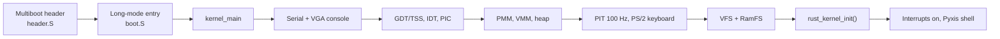
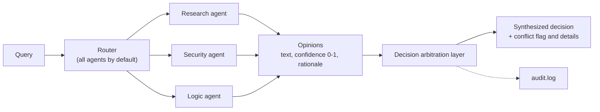

<div align="center">

```text
    ____             _      ____  _____
   / __ \__  ___  __(_)____/ __ \/ ___/
  / /_/ / / / / |/_/ / ___/ / / /\__ \
 / ____/ /_/ />  </ (__  ) /_/ /___/ /
/_/    \__, /_/|_/_/____/\____//____/
      /____/
```

**LUNAR-PYXIS // BETA**

*An experimental AI-oriented operating-system project for physical x86_64 hardware.
A Linux-based foundation you can run today, a native systems stack under construction,
and an architecture where AI agents are governed system participants.*

[](VERSION)
[](docs/PROJECT_STATUS.md)
[](docs/installation/hardware-setup.md)
[](LICENSE)
[](.github/workflows/consensus-ci.yml)
[](https://github.com/obstinix/PyxisOS/commits)

[Overview](#overview) · [Status](#status-at-a-glance) · [Quick start](#quick-start) · [Architecture](#architecture) · [Components](#components) · [Research](#research) · [Roadmap](#roadmap) · [Docs](#documentation-map) · [Contributing](#contributing)

</div>

---

> [!IMPORTANT]
> PyxisOS is beta research software. **Track A**, the part you can run on real hardware today, sits on the upstream Linux kernel. **Track B**, the native kernel, is built as a Multiboot ELF and targets QEMU; it has not been booted on bare metal. Don't use PyxisOS where you need a production-grade system, and back up before touching a boot loader.

## Overview

PyxisOS asks one question: what does an operating system look like when AI agents are first-class, *governed* participants instead of ordinary userspace programs? The long-term answer is an OS where agents act through capability-scoped permissions, contested decisions go through arbitration, and risky actions pass approval gates.

The project is built on two tracks so it stays usable while the ambitious parts mature:

```text
PyxisOS
│
├── Track A — Operational foundation            runs on hardware today
│   ├── Upstream Linux kernel (drivers, ACPI, NVMe, Wi-Fi)
│   ├── KDE Plasma 6 on Wayland, SDDM, NetworkManager
│   └── pyxis CLI, branding, boot-loader references
│
└── Track B — Native stack                      built in parallel
    ├── Freestanding x86_64 kernel (C + Assembly + Rust core)   QEMU
    ├── Lunar Core         Rust #![no_std] kernel entry           experimental
    ├── Astral Consensus   multi-agent arbitration engine         hosted, in development
    ├── Aegis              capability + sandbox model             prototype
    ├── Celestial Automation   workflow orchestration             planned
    └── Nebula             spatial interface research             research
```

> **Architectural premise:** the Linux foundation is an operational substrate for developing PyxisOS, not its final destination.

| PyxisOS is | PyxisOS is not (yet) |
|---|---|
| A research project on agent-governed operating systems | An independent kernel or self-hosting distribution |
| A usable Linux-based environment on real hardware (Track A) | Production-grade |
| A native x86_64 kernel plus Rust components, developed alongside it (Track B) | A near-term replacement for the Linux kernel; layers are replaced or customized progressively |
| Designed around capability checks and approval gates | A system that gives agents unrestricted root |

## Status at a glance

```text
version   0.1.0   (Lunar-Pyxis)
stage     Beta / Experimental
target    x86_64 physical hardware   (reference machine: ThinkPad X1 Carbon 5th Gen)
```

`WORKING` runs today · `IN DEVELOPMENT` source exists, integration ongoing · `EXPERIMENTAL` early prototype · `PROTOTYPE` demonstrable model · `PLANNED` specified, not built · `LONG-TERM` research goal

| Component | Status | What it is today | Location |
|---|---|---|---|
| Linux operational substrate | `WORKING` | Upstream Linux on the reference machine | — |
| Identity and branding | `WORKING` | `/etc/os-release`, terminal banner | `system/branding/` |
| Management CLI | `WORKING` | Bash tool; `info`, `system`, `status` read live system state, `doctor` prints a fixed report | `cli/pyxis` |
| Desktop | `WORKING` | KDE Plasma 6, SDDM | `desktop/kde/` |
| Freestanding kernel (C + Assembly) | `IN DEVELOPMENT` | Multiboot ELF run under QEMU | `arch/` `kernel/core/` `mm/` `fs/` `drivers/` `userspace/` |
| Rust kernel core | `IN DEVELOPMENT` | Static library linked into the kernel image; boot calls `rust_kernel_init()`; scheduler and IPC are exported over FFI | `kernel/src/` |
| Lunar Core | `EXPERIMENTAL` | Standalone `#![no_std]` Rust kernel entry, built separately from the C kernel image | `native/lunar-core/` |
| Astral Consensus | `IN DEVELOPMENT` | Hosted Rust library and CLI with LLM-backed and deterministic engines | `native/consensus/` |
| Aegis | `PROTOTYPE` | Host-tested Rust library: capability tokens, sandbox lifecycle, software isolation checks | `native/aegis/` |
| Nebula | `PROTOTYPE` | Research notes | `research/nebula/` |
| Celestial Automation | `PLANNED` | Architecture spec | `docs/subsystems/automation.md` |
| Native AI-oriented OS | `LONG-TERM` | Integration goal across all of the above | `docs/ROADMAP.md` |

[`docs/PROJECT_STATUS.md`](docs/PROJECT_STATUS.md) is the canonical status document.

## Quick start

### Build and boot the native kernel in QEMU

**Prerequisites**

| Tool | Notes |
|---|---|
| `clang` + `ld.lld` | The Makefile compiles and links with LLVM |
| GNU Make | `mingw32-make` also works under MSYS2; `scripts/build.sh` falls back to a direct clang pipeline without Make |
| Rust via `rustup` | Add the bare-metal target: `rustup target add x86_64-unknown-none`. The `native/` workspace pins a nightly toolchain in `native/rust-toolchain.toml`, which rustup installs automatically |
| Python 3 | Used by `tools/python/build_dirs.py`. If your system has no `python` binary, run `make PYTHON=python3` |
| QEMU | `qemu-system-x86_64`, to run the kernel |
| GDB | Optional, for `make debug` |

Full workstation setup (Windows/MSYS2, macOS, Linux): [`docs/onboarding/development-environment-setup.md`](docs/onboarding/development-environment-setup.md).

```bash
git clone https://github.com/obstinix/PyxisOS.git
cd PyxisOS

make check    # detect the toolchain, cargo-check the Rust kernel crate
make build    # produce bin/pyxis-kernel.elf
make run      # boot it in QEMU (serial on stdio, 128 MB RAM)
make debug    # QEMU paused with a GDB stub on tcp::1234
make test     # build, check the ELF exists, run the CLI smoke tests
make clean    # remove build artifacts (distclean also clears the Python cache)
```

To attach a debugger: run `make debug`, then in another terminal `gdb bin/pyxis-kernel.elf` and `(gdb) target remote :1234`.

The kernel brings up serial and VGA consoles, GDT/IDT/PIC, memory management, timer and keyboard, an in-memory filesystem, and the Rust core, then drops into the built-in shell: `help`, `info`, `mem`, `uptime`, `clear`, `reboot`.

### Try Astral Consensus (no kernel needed)

```bash
# Offline, using the built-in mock provider
cargo run --manifest-path native/consensus/Cargo.toml -- "Verify page-table isolation for a microkernel" --mock

# Live, using an Anthropic API key (requires curl)
export ANTHROPIC_API_KEY="..."
cargo run --manifest-path native/consensus/Cargo.toml -- "Verify page-table isolation for a microkernel"

cargo test --manifest-path native/consensus/Cargo.toml
cargo test --manifest-path native/aegis/Cargo.toml
```

Set `ANTHROPIC_MODEL` to override the default model. Runs append events to `audit.log` in the working directory.

### Install the `pyxis` CLI (Track A, Linux)

```bash
sudo ./scripts/cli.sh     # installs cli/pyxis to /usr/local/bin/pyxis
```

```text
pyxis info       OS identity, hardware, desktop        (default when run with no command)
pyxis system     CPU, memory, uptime, storage
pyxis status     SDDM and NetworkManager state, boot entry
pyxis doctor     six-section health report (see Known limitations)
pyxis version    release version and codename
pyxis help       usage
```

### Verify the repository

```bash
./scripts/verify.sh       # required files present, shell scripts parse
./tests/cli_test.sh       # CLI smoke tests
cd native && cargo check --workspace
```

## Architecture

### Target stack

The long-term architecture, as defined in [`docs/PROJECT_VISION.md`](docs/PROJECT_VISION.md), has seven tiers. Today's implementation status is on the right.

```text
┌─────────────────────────────────────────┐
│        Applications / Agents            │
├─────────────────────────────────────────┤
│  Human + Spatial Interface   (Nebula)   │  research
├─────────────────────────────────────────┤
│  System Services  (Celestial Automation)│  planned
├─────────────────────────────────────────┤
│  Multi-Agent Coordination (Astral       │  hosted engine,
│  Consensus)                             │  in development
├─────────────────────────────────────────┤
│  AI Runtime                             │  planned
├─────────────────────────────────────────┤
│  Isolation / Execution Layer  (Aegis)   │  software prototype
├─────────────────────────────────────────┤
│  Native Systems Layer  (Lunar Core /    │  C/ASM kernel in QEMU,
│  Pyxis Kernel)                          │  Rust core partly wired
├─────────────────────────────────────────┤
│  Physical x86_64 hardware               │
└─────────────────────────────────────────┘
        Track A (Linux) carries the hardware workload today.
```

### Native kernel boot flow



### Astral Consensus pipeline



A second, **deterministic** engine (security, logic, and resource agents voting on structured proposals and evidence, with a deterministic arbitrator) runs with no LLM or network access.

## Components

### Freestanding kernel (C, Assembly)

| Area | Implementation | Path |
|---|---|---|
| Boot | Multiboot header, 32-bit bootstrap into 64-bit long mode | `arch/x86_64/boot/` |
| CPU tables | 64-bit GDT and TSS, 256-entry IDT | `arch/x86_64/cpu/` |
| Interrupts | Assembly ISR/IRQ stubs, 8259 PIC remapped to vectors 32-47 | `arch/x86_64/interrupts/` |
| Context and syscalls | Context-switch routine and syscall entry in Assembly | `arch/x86_64/context/`, `arch/x86_64/syscall/` |
| Physical memory | Bitmap frame allocator | `mm/pmm.c` |
| Virtual memory | 4-level PML4 paging | `mm/vmm.c` |
| Heap | Boundary-tag kernel allocator | `mm/heap.c` |
| Drivers | 16550 UART, VGA text, 8254 PIT, PS/2 keyboard | `drivers/` |
| Filesystem | Virtual filesystem switch and RamFS | `fs/` |
| Shell | Built-in interactive console | `userspace/shell/` |

### Rust components

| Component | What it contains | Notes |
|---|---|---|
| **Rust kernel core** (`kernel/src/`) | `Task`, round-robin scheduler, spinlock, typed IPC channels, FFI exports | Linked into the kernel image as `libpyxis_kernel.a`. The C kernel calls `rust_kernel_init()` at boot; the scheduler and IPC exports are not yet driven by the C kernel |
| **Lunar Core** (`native/lunar-core/`) | `#![no_std]` entry point, GDT/IDT descriptors, Multiboot 1/2 structures, PML4 and address types, bump and frame allocators, COM1 serial logging | Custom target spec `x86_64-pyxis.json`. Not a complete microkernel and not part of the C kernel image |
| **Astral Consensus** (`native/consensus/`) | Research, security and logic agents; router; arbitration layer; audit logger; deterministic engine; CLI | Standard-library Rust, runs as a hosted program. CI runs its tests |
| **Aegis** (`native/aegis/`) | Capability tokens with a rights bitmask, delegation that can only narrow rights, revocation, sandbox lifecycle with memory and channel limits, a software isolation boundary | Library with unit tests. Hardware virtualization is a stub that reports unsupported |

### Pyxis management CLI and system files

Track A tooling lives in `cli/pyxis`, `system/branding/` (os-release, banner), `system/boot/` (boot-loader reference configs and recovery notes) and `desktop/kde/`. Boot and dual-boot instructions are written for the reference machine; adapt device paths before reusing them. See [`docs/installation/`](docs/installation).

## Research

The central open question is whether **multi-agent consensus beats a single-agent baseline**. The evaluation harness in `research/eval/` is ready:

- 16 fixed prompts across coding, logic, safety and search (`prompts.json`)
- A 1-5 rubric over correctness, completeness, safety-awareness and clarity (`rubric.md`)
- A single-agent Claude baseline (`run_baseline.py`), the consensus pipeline (`run_consensus.py`) and an LLM-judge scorer (`score.py`)

**No evaluation run has been executed yet**, so there are no results to report. [`research/results/v1-baseline-vs-consensus.md`](research/results/v1-baseline-vs-consensus.md) has the run instructions and will hold the numbers.

Related: [`docs/PRD.md`](docs/PRD.md) · [`docs/research-paper/outline.md`](docs/research-paper/outline.md)

## Roadmap

| Phase | Focus | Status |
|---|---|---|
| 1 | Operational foundation (Linux substrate, CLI, desktop, diagnostics) | Substantially implemented |
| 2 | Native systems research (kernel core, memory, Lunar Core) | Active development |
| 3 | Agentic OS architecture (Astral Consensus, agent roles, capability model) | Research / in development |
| 4 | Isolation and automation (Aegis, Celestial Automation) | Planned; a software Aegis prototype has landed |
| 5 | Native AI-oriented OS | Long-term research goal |

Open items called out in [`docs/ROADMAP.md`](docs/ROADMAP.md) include booting the kernel image on test hardware, full C/Rust FFI integration of the scheduler, agent lifecycle management, and hardware-enforced isolation.

## Repository layout

```text
PyxisOS/
├── Makefile             build · check · run · debug · test · clean
├── linker.ld            kernel linker script
├── VERSION  CHANGELOG.md  LICENSE  CONTRIBUTING.md  CODE_OF_CONDUCT.md  SECURITY.md
│
├── arch/x86_64/         boot, CPU tables, interrupts, context switch, syscall entry
├── boot/                Multiboot structures and boot parameters
├── kernel/
│   ├── core/            C kernel entry, console output, panic, syscalls
│   └── src/             Rust kernel core crate (task, scheduler, sync, ipc, ffi)
├── mm/                  physical memory, paging, heap
├── drivers/             char (UART) · video (VGA) · timer (PIT) · input (PS/2)
├── fs/                  VFS and RamFS
├── include/             kernel headers and syscall UAPI
├── userspace/shell/     built-in kernel shell
│
├── native/              Rust workspace: lunar-core · consensus · aegis
├── research/            evaluation harness, results log, consensus and Nebula notes
│
├── cli/pyxis            management CLI (Track A)
├── system/              branding, boot-loader references, service notes
├── desktop/kde/         desktop environment notes
│
├── scripts/             build · run · debug · test · verify · toolchain · clean · CLI installer
├── tests/               CLI smoke tests
├── tools/python/        build-dir generation, memory-layout analysis, language metrics
├── docs/                vision, status, roadmap, PRD, architecture, subsystems, guides
└── .github/             issue templates and the Consensus CI workflow
```

## Documentation map

| Topic | Documents |
|---|---|
| Direction | [Vision](docs/PROJECT_VISION.md) · [Roadmap](docs/ROADMAP.md) · [Status](docs/PROJECT_STATUS.md) · [PRD](docs/PRD.md) |
| Architecture | [System overview](docs/architecture/system-overview.md) · [Boot sequence](docs/architecture/boot-sequence.md) · [Boot flow](docs/architecture/boot-flow.md) · [Memory](docs/architecture/memory-subsystem.md) · [Scheduling](docs/architecture/scheduling-subsystem.md) · [Language boundaries](docs/architecture/language-boundaries.md) · [Language composition](docs/architecture/language-composition.md) |
| Subsystems | [Automation](docs/subsystems/automation.md) · [Intelligence](docs/subsystems/intelligence.md) · [Network](docs/subsystems/network.md) · [Shell](docs/subsystems/shell.md) |
| Setup | [Dev environment](docs/onboarding/development-environment-setup.md) · [Hardware setup](docs/installation/hardware-setup.md) · [Dual-boot guide](docs/installation/dual-boot-guide.md) |
| Provenance | [Upstream Linux](docs/UPSTREAM_LINUX.md) |
| History | [Changelog](CHANGELOG.md) · [Milestones](docs/milestones/) |

## Known limitations

PyxisOS is deliberately specific about what is and isn't built.

1. **Linux dependency.** Everything you can run on real hardware today rides on the upstream Linux kernel. PyxisOS is not yet an independent, self-hosting system.
2. **Native kernel.** It targets QEMU and has not been booted on bare metal. C-to-Rust integration is partial: only `rust_kernel_init()` is called from C.
3. **Lunar Core** is a prototype kernel entry, not a complete microkernel, and it is not linked into the C kernel image.
4. **Aegis** is a software model. Capability tokens are ordinary Rust structs (not cryptographically signed), nothing is enforced by hardware, and it is not yet connected to the kernel or to Astral Consensus.
5. **Astral Consensus** runs as a hosted program, and its LLM mode depends on an external API. Whether consensus outperforms a single agent is untested.
6. **`pyxis doctor`** currently prints a fixed six-section report; live probing of each subsystem is not implemented.
7. **Test coverage is thin.** CLI smoke tests and unit tests for Consensus and Aegis exist; CI covers Consensus only, and the kernel has no automated boot test.
8. **Nebula and Celestial Automation** are research and specification only.

## Contributing

Contributions are welcome, especially around kernel bring-up, the C/Rust boundary, Aegis hardware isolation, and the consensus evaluation. Read [`CONTRIBUTING.md`](CONTRIBUTING.md) and the [Code of Conduct](CODE_OF_CONDUCT.md). Issue templates cover bug reports, feature requests, and new agent proposals. Report vulnerabilities as described in [`SECURITY.md`](SECURITY.md).

## License and provenance

- **PyxisOS original code:** [Apache License 2.0](LICENSE). Copyright 2026 The PyxisOS Authors.
- **Track A base:** an Arch-derived Linux userland on the upstream Linux kernel, which is licensed [`GPL-2.0-only`](https://github.com/torvalds/linux) and is not PyxisOS-original code.
- Attribution and license separation are documented in [`docs/UPSTREAM_LINUX.md`](docs/UPSTREAM_LINUX.md).
