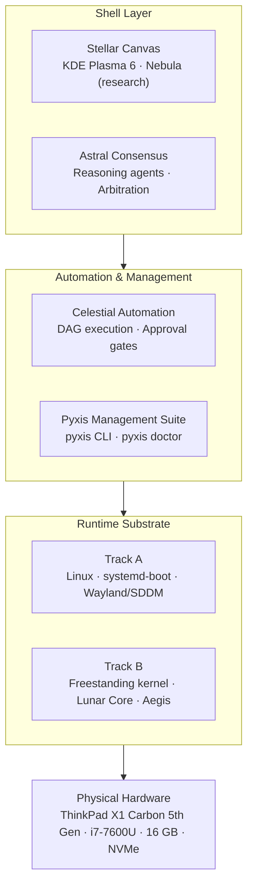
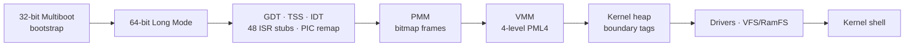

<div align="center">

```
    ____             _      ____  _____
   / __ \__  ___  __(_)____/ __ \/ ___/
  / /_/ / / / / |/_/ / ___/ / / /\__ \
 / ____/ /_/ />  </ (__  ) /_/ /___/ /
/_/    \__, /_/|_/_/____/\____//____/
      /____/
```

### An experimental AI‑oriented operating system for real x86_64 hardware

**`LUNAR-PYXIS`** · **`v0.1.0`** · **`BETA`**

[](VERSION)
[](docs/PROJECT_STATUS.md)
[](docs/installation/hardware-setup.md)
[](LICENSE)


[**Vision**](docs/PROJECT_VISION.md) · [**Roadmap**](docs/ROADMAP.md) · [**Status**](docs/PROJECT_STATUS.md) · [**Architecture**](docs/architecture/system-overview.md) · [**Contributing**](CONTRIBUTING.md)

</div>

---

> [!NOTE]
> PyxisOS runs today on a **Linux operational foundation** while a **native kernel** is built alongside it. Linux is the scaffolding, not the destination.

## Table of Contents

- [What is PyxisOS?](#-what-is-pyxisos)
- [Status at a Glance](#-status-at-a-glance)
- [Architecture](#-architecture)
- [Track A — Operational Environment](#-track-a--operational-environment)
- [Track B — Native Systems Architecture](#-track-b--native-systems-architecture)
- [Quick Start](#-quick-start)
- [Repository Layout](#-repository-layout)
- [Known Limitations](#-known-limitations)
- [Documentation](#-documentation)
- [Contributing](#-contributing)
- [License & Provenance](#-license--provenance)

---

## 🌌 What is PyxisOS?

PyxisOS is an experimental operating‑system project targeting **physical x86_64 hardware**. It explores what an OS looks like when multi‑agent reasoning, capability isolation, and autonomous orchestration are treated as first‑class system primitives rather than applications bolted on top.

The project follows a deliberate **two‑track strategy**:

| | Track A — Operational Foundation | Track B — Native AI‑OS Architecture |
|---|---|---|
| **Purpose** | A usable OS on real hardware, today | The long‑term native replacement |
| **Core** | Linux kernel substrate | Freestanding x86_64 kernel + Lunar Core |
| **Languages** | Shell, upstream Linux | C, Rust `#![no_std]`, x86_64 Assembly |
| **Maturity** | Working | In development / experimental |

This keeps the project continuously usable and validated on physical hardware without compromising the long‑term native design.

---

## 📊 Status at a Glance

| Component | Status | Implementation | Location |
|---|---|---|---|
| Physical x86_64 environment | 🟢 Working | Bare‑metal x86_64 | ThinkPad X1 Carbon 5th Gen |
| PyxisOS identity | 🟢 Working | Shell / metadata | `system/branding/` |
| System management CLI | 🟢 Working | POSIX shell | `cli/pyxis` |
| Diagnostics | 🟢 Working | POSIX shell | `cli/pyxis`, `tests/` |
| Desktop environment | 🟢 Working | KDE Plasma / Wayland | `desktop/kde/` |
| Linux operational substrate | 🟢 Working | Linux 6.x upstream | Track A |
| Astral Consensus | 🟡 In development | Rust | `native/consensus/` |
| Lunar Core | 🟠 Experimental | Rust `#![no_std]` | `native/lunar-core/` |
| Nebula | 🟠 Prototype | Research & spec | `research/nebula/` |
| Aegis | ⚪ Planned | Rust / capability spec | `native/aegis/` |
| Celestial Automation | ⚪ Planned | DAG orchestration spec | `docs/PROJECT_VISION.md` |
| Native AI‑oriented OS | 🔭 Research goal | Integrated architecture | `docs/ROADMAP.md` |

The canonical, detailed matrix lives in [`docs/PROJECT_STATUS.md`](docs/PROJECT_STATUS.md).

---

## 🏗 Architecture



<details>
<summary><b>Full layered diagram (text)</b></summary>

```
┌────────────────────────────────────────────────────────────────────────┐
│                        PyxisOS Shell Layer                             │
│   Stellar Canvas (Desktop UX)        Astral Consensus Engine           │
│   • KDE Plasma 6 (Track A)           • Specialized Reasoning Agents    │
│   • Nebula Spatial (Research)        • Decision Arbitration Layer      │
├────────────────────────────────────────────────────────────────────────┤
│                       Automation & Management                          │
│   Celestial Automation Engine        Pyxis Management Suite            │
│   • Task Graph (DAG) Execution       • Pyxis CLI (/usr/local/bin/pyxis)│
│   • Cryptographic Approval Gates     • Pyxis Doctor Diagnostics        │
├────────────────────────────────────────────────────────────────────────┤
│                       Runtime Host Substrate                           │
│   Track A: Linux substrate · systemd-boot 261.2 + Win10 dual boot      │
│            Wayland / SDDM / NetworkManager                             │
│   Track B: Freestanding x86_64 kernel · Lunar Core · Aegis (planned)   │
├────────────────────────────────────────────────────────────────────────┤
│   Lenovo ThinkPad X1 Carbon 5th Gen (Intel i7-7600U, 16GB RAM, NVMe)   │
└────────────────────────────────────────────────────────────────────────┘
```

</details>

---

## 🖥 Track A — Operational Environment

A fully functional OS on real hardware, used for daily development, multi‑agent evaluation, and hardware telemetry.

- **Desktop** — KDE Plasma 6 on Wayland via SDDM
- **Boot** — UEFI dual boot alongside Windows 10 with `systemd-boot 261.2`
- **Management** — `/usr/local/bin/pyxis` for inspection, service monitoring, and diagnostics
- **Hardware** — Intel Core i7‑7600U, NVMe storage, Wi‑Fi, Intel HD Graphics, ThinkPad power/thermal management

### `pyxis` CLI

```console
$ pyxis info      # OS identity, hardware spec, desktop status
$ pyxis system    # CPU load, memory, uptime, storage mounts
$ pyxis status    # SDDM, NetworkManager, boot services
$ pyxis doctor    # Health check across 6 subsystems
$ pyxis version   # 0.1.0 · Lunar-Pyxis · Beta
$ pyxis help      # Usage
```

---

## ⚙️ Track B — Native Systems Architecture

The low‑level foundation intended to eventually succeed the Linux substrate.

### Freestanding x86_64 Kernel



| Subsystem | Details | Path |
|---|---|---|
| Boot | 32‑bit Multiboot → 64‑bit Long Mode | `arch/x86_64/boot/` |
| CPU & interrupts | 64‑bit GDT, TSS, IDT, 48 assembly ISR stubs, 8259 PIC remapping | `arch/x86_64/cpu/`, `arch/x86_64/interrupts/` |
| Physical memory | Bitmap frame allocator | `mm/pmm.c` |
| Virtual memory | 4‑level PML4 paging | `mm/vmm.c` |
| Kernel heap | Boundary‑tag allocator | `mm/heap.c` |
| Drivers | 16550 UART, VGA text, 8254 PIT, PS/2 keyboard | `drivers/` |
| Filesystem | In‑memory VFS switch + RamFS | `fs/vfs.c`, `fs/ramfs.c` |
| Shell | Early interactive kernel console | `userspace/shell/` |

### Native Rust Components

| Component | Role | Status |
|---|---|---|
| 🌙 **Lunar Core** — `native/lunar-core/` | `#![no_std]` microkernel crate: safe `Task` representation, round‑robin scheduler, typed IPC channels | 🟠 Experimental |
| ✨ **Astral Consensus** — `native/consensus/` | Multi‑agent reasoning & arbitration: structured proposals, evidence logging, confidence scoring, conflict resolution for OS actions | 🟡 In development |
| 🛡 **Aegis** — `native/aegis/` | Capability‑based security layer & sandbox isolating autonomous agent workloads | ⚪ Planned |

---

## 🚀 Quick Start

```bash
# Clone
git clone https://github.com/obstinix/PyxisOS.git
cd PyxisOS

# Verify repository integrity, paths, and shell syntax
./scripts/verify.sh

# Run CLI test suite
./tests/cli_test.sh

# Build freestanding kernel components
make build

# Validate the native Rust workspace
cd native && cargo check --workspace
```

> [!TIP]
> Toolchain and workstation setup is covered in [`docs/onboarding/`](docs/onboarding/). Hardware and dual‑boot setup is in [`docs/installation/`](docs/installation/).

---

## 📁 Repository Layout

<details>
<summary><b>Expand tree</b></summary>

```
PyxisOS/
├── Makefile              # Build orchestrator (build, check, test, clean)
├── linker.ld             # Kernel linker script (_start at 1 MB)
├── VERSION               # 0.1.0
├── CHANGELOG.md · CONTRIBUTING.md · CODE_OF_CONDUCT.md · SECURITY.md · LICENSE
│
├── arch/x86_64/          # Multiboot bootstrap, GDT, IDT, ISRs, context switch
├── boot/                 # Multiboot headers & boot parameters
├── drivers/              # UART, VGA, PIT, PS/2
├── fs/                   # VFS + RamFS
├── include/              # Kernel headers (pyxis/) + UAPI (syscalls)
├── kernel/               # C kernel core + Rust scheduler/IPC bindings
├── mm/                   # PMM, PML4 paging, heap
│
├── cli/                  # pyxis management CLI
├── desktop/kde/          # Desktop environment configuration
├── system/               # Boot config templates & branding
├── userspace/shell/      # Interactive kernel shell
│
├── native/               # Rust workspace
│   ├── lunar-core/       # #![no_std] microkernel (experimental)
│   ├── consensus/        # Astral Consensus (in development)
│   └── aegis/            # Capability isolation (planned)
│
├── research/             # consensus/ · eval/ · nebula/ · results/
├── docs/                 # vision, roadmap, status, architecture, installation, milestones, onboarding
├── scripts/              # build, run, test, toolchain, verification
├── tools/python/         # Python helper tooling
└── tests/                # Automated test suites
```

</details>

---

## ⚠️ Known Limitations

PyxisOS is explicit about where it stands:

1. **Linux substrate** — On physical machines, PyxisOS currently depends on Linux (Track A). It is not yet a self‑hosting, independent kernel distribution.
2. **Lunar Core** — An experimental `#![no_std]` prototype. It compiles and validates against its target spec; replacing the operational substrate is an active research goal.
3. **Aegis** — An architecturally planned capability model, not a completed Type‑1 hypervisor.
4. **Nebula** — Exploratory spatial‑interface research. Day‑to‑day desktop use runs on KDE Plasma / Wayland.

---

## 📚 Documentation

| Document | Description |
|---|---|
| [Project Vision](docs/PROJECT_VISION.md) | Long‑term systems and AI‑OS technical vision |
| [Roadmap](docs/ROADMAP.md) | Five‑phase milestone plan |
| [Project Status](docs/PROJECT_STATUS.md) | Canonical subsystem readiness matrix |
| [System Overview](docs/architecture/system-overview.md) | Subsystem architecture |
| [Memory Subsystem](docs/architecture/memory-subsystem.md) | PMM, VMM, and heap design |
| [Boot Sequence](docs/architecture/boot-sequence.md) | From Multiboot to Long Mode |
| [Upstream Linux](docs/UPSTREAM_LINUX.md) | Provenance and licensing boundaries |
| [Changelog](CHANGELOG.md) | Release history |

---

## 🤝 Contributing

Contributions, issues, and design discussion are welcome.

1. Read [`CONTRIBUTING.md`](CONTRIBUTING.md) and the [Code of Conduct](CODE_OF_CONDUCT.md)
2. Run `./scripts/verify.sh` and the test suites before opening a PR
3. Report security issues privately per [`SECURITY.md`](SECURITY.md)

---

## 📜 License & Provenance

- **PyxisOS original code** — [Apache License 2.0](LICENSE). Copyright 2026 The PyxisOS Authors.
- **Upstream Linux substrate** — [GPL‑2.0‑only](https://github.com/torvalds/linux), per upstream.
- Full attribution and licensing separation: [`docs/UPSTREAM_LINUX.md`](docs/UPSTREAM_LINUX.md).

---

<div align="center">

**Built from first principles by [obstinix](https://github.com/obstinix)**

If PyxisOS interests you, consider leaving a ⭐

</div>
